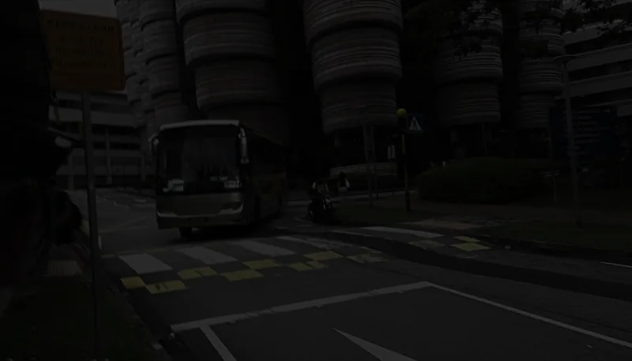
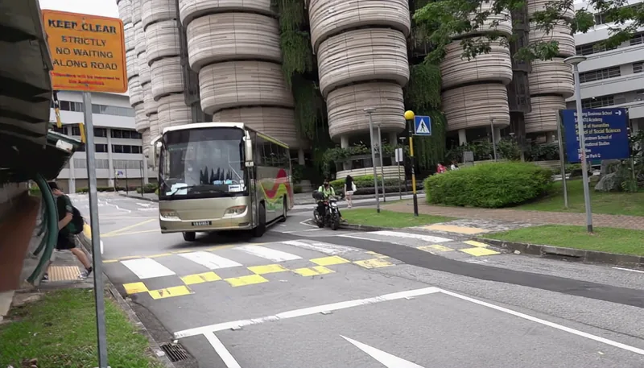
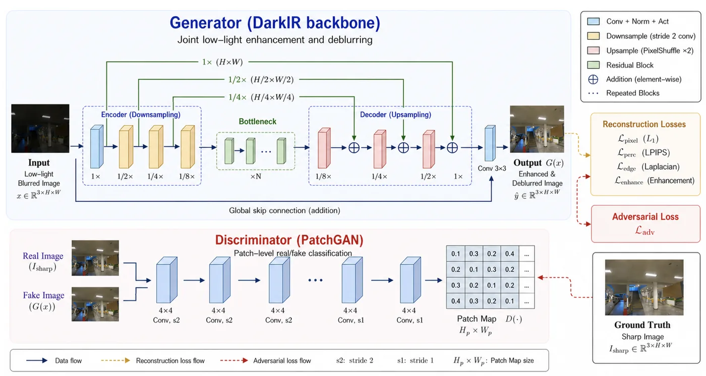
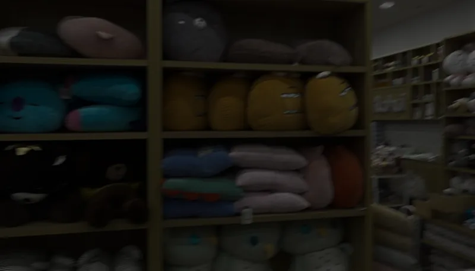
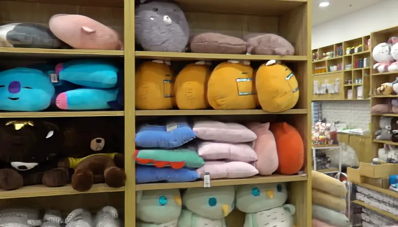
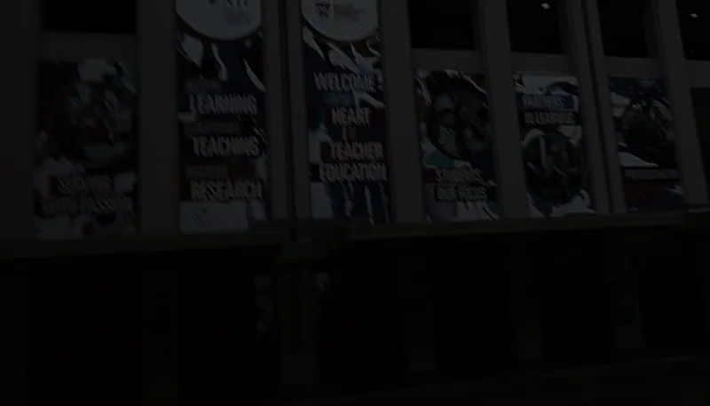
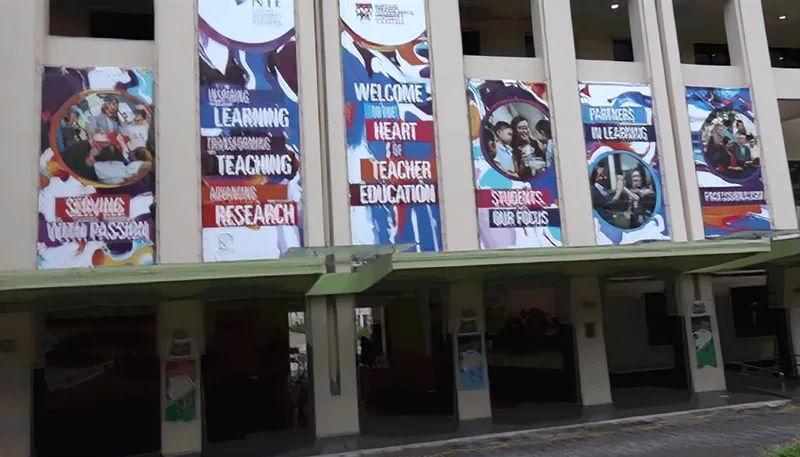
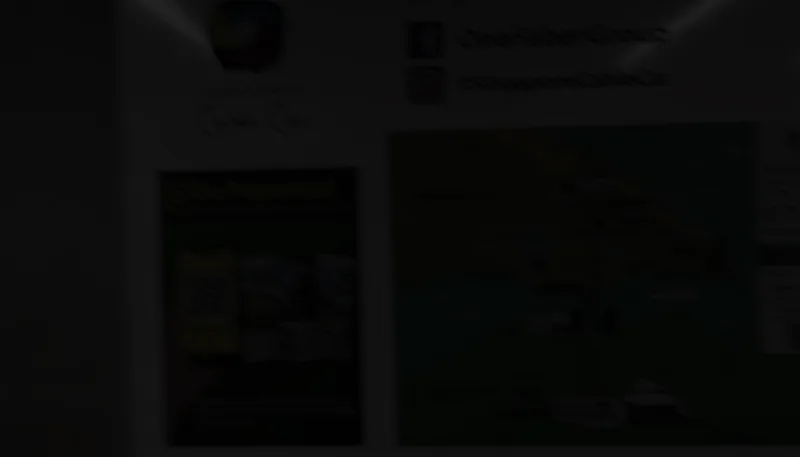
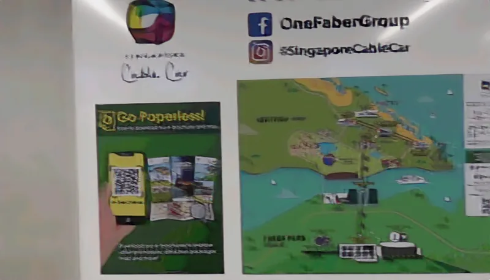

# DarkIR-GAN: GAN-Based Low-Light Blurred Image Restoration

**Xinyu He** · **Shi Yan** · School of Information Science and Engineering, Lanzhou University

**Accepted at VSIP 2026**

[**Project Page**](https://david-he-nj.github.io/DarkIR-GAN/) · [**Paper (PDF)**](https://david-he-nj.github.io/DarkIR-GAN/assets/DarkIR-GAN.pdf) · [**Model Checkpoints**](https://github.com/David-He-NJ/DarkIR-GAN/releases/tag/v1.0.0) · [**Citation**](#citation)

Official research code for **DarkIR-GAN: GAN-Based Low-Light Blurred Image Restoration**.

DarkIR-GAN keeps the DarkIR generator and the continued-baseline reconstruction recipe, then adds a five-layer PatchGAN discriminator trained with a least-squares adversarial objective. The repository includes the matched Stage III baseline and adversarial branches used for the paper comparison.

## Visual overview

A representative comparison from the [interactive project gallery](https://david-he-nj.github.io/DarkIR-GAN/):

| Low-light blurred input | Restored by DarkIR-GAN |
|:---:|:---:|
|  |  |

### Architecture

[](assets/architecture.webp)

DarkIR-GAN preserves the **DarkIR generator and its reconstruction losses**, then adds a **five-layer PatchGAN discriminator** with a least-squares adversarial objective. Only the generator is needed for restoration at inference time. See [implementation notes](docs/implementation_notes.md) for the controlled setup and loss coefficients.

## Main result

Both branches restore the same Stage II checkpoint, optimizer state and scheduler state, then train for another 30 epochs. The table reports the final checkpoint on the complete 1,800-image LOL-Blur validation split.

| Method | PSNR ↑ | SSIM ↑ | LPIPS ↓ | MUSIQ ↑ | NIQE ↓ | NRQM ↑ |
|---|---:|---:|---:|---:|---:|---:|
| Baseline-continued | 24.803 | **0.8558** | 0.1530 | 55.163 | 5.366 | 5.102 |
| DarkIR-GAN | **24.940** | 0.8553 | **0.1301** | **60.718** | **4.737** | **5.983** |

The raw ten-point trajectories are in [`results/stage3/`](results/stage3/). Run `python scripts/summarize_stage3.py --check` to verify their hashes, epoch schedule and reported endpoint values.

This is a single-run controlled comparison. The two branches are matched in configuration, data split, initialization and training budget, but the historical sampler did not record a seed or consumed-sample manifest, so batch-for-batch identity is not claimed.

At the final epoch, DarkIR-GAN achieves **14.97% lower LPIPS** and **10.07% higher MUSIQ** than the continued baseline, with a **0.137 dB increase in PSNR** and a **0.0005 decrease in SSIM**. These are descriptive differences for this matched single-run experiment, not uncertainty-adjusted estimates.

## Qualitative results

Additional examples from the [project page](https://david-he-nj.github.io/DarkIR-GAN/). Each pair shows the same scene before and after restoration.

| Scene | Low-light blurred input | DarkIR-GAN output |
|:---|:---:|:---:|
| Shop |  |  |
| Posters |  |  |
| Map |  |  |

The full interactive comparison and the paper are available on the [project website](https://david-he-nj.github.io/DarkIR-GAN/). These visual examples supplement, rather than replace, the full-validation metrics and reproducibility records below.

## Repository map

```text
training/
├── baseline/                 # Stage I/II historical entry points
├── baseline_continued/       # Stage III reconstruction-only control
└── gan/                      # Stage III DarkIR-GAN used in the paper
results/stage3/               # Full-validation CSVs and audit metadata
scripts/                      # Release checks, result verification and launch wrapper
environment/                  # AutoDL runtime version record
docs/                         # Implementation and reproduction notes
```

`training/gan/` is the paper implementation. An earlier pre-control prototype
that changed several generator-side variables is intentionally excluded from
the public release.

## Environment

The completed AutoDL runs used:

- Python 3.10.12
- PyTorch 2.5.1+cu124
- torchvision 0.20.1+cu124
- CUDA 12.4
- NVIDIA GeForce RTX 4080 SUPER

Install the CUDA build of PyTorch first, then the recorded direct dependencies:

```bash
python -m venv .venv
source .venv/bin/activate
pip install torch==2.5.1 torchvision==0.20.1 \
  --index-url https://download.pytorch.org/whl/cu124
pip install -r requirements.txt
```

See [`environment/autodl-cu124.txt`](environment/autodl-cu124.txt) for the versions observed in the completed runs. The local IQA-PyTorch snapshot reported version `0.0.0` and did not preserve its upstream commit identifier; this remaining provenance gap is documented rather than replaced with an invented version.

## Data and required assets

Obtain LOL-Blur under its own distribution terms and use this layout:

```text
datasets/LOL-Blur/
├── train/
│   ├── low_blur/<scene>/<image>.png
│   └── high_sharp_original/<scene>/<image>.png
└── val/
    ├── low_blur/<scene>/<image>.png
    └── high_sharp_original/<scene>/<image>.png
```

The completed runs contained 20,400 training images and 3,600 validation images. The repository does not redistribute the dataset or third-party IQA weights. Model checkpoints are hosted separately from Git; the verified asset manifest and release filenames are documented in [`docs/model_assets.md`](docs/model_assets.md).

Place the metric assets at:

```text
weights/iqa/lpips.pth
weights/iqa/musiq.pth
weights/iqa/niqe.mat
weights/iqa/nrqm.mat
```

Place the shared Stage II initialization at:

```text
training/baseline/experiments/checkpoints/baseline_best_psnr.pt
```

Its required SHA-256 is:

```text
dbfdc6494daae9a809607f63e74a6193a8b4ed0004c02ae9f23dda1cfc723a99
```

## Model checkpoints

The seven verified checkpoint files are hosted separately in the
[`v1.0.0` model release](https://github.com/David-He-NJ/DarkIR-GAN/releases/tag/v1.0.0):

| Artifact | Download |
|---|---|
| Shared Stage II initialization | [`darkir_stage2_init_baseline_best_psnr.pt`](https://github.com/David-He-NJ/DarkIR-GAN/releases/download/v1.0.0/darkir_stage2_init_baseline_best_psnr.pt) |
| Stage III baseline, epoch 30 | [`darkir_stage3_baseline_epoch_30.pt`](https://github.com/David-He-NJ/DarkIR-GAN/releases/download/v1.0.0/darkir_stage3_baseline_epoch_30.pt) |
| Stage III baseline, best PSNR | [`darkir_stage3_baseline_best_psnr.pt`](https://github.com/David-He-NJ/DarkIR-GAN/releases/download/v1.0.0/darkir_stage3_baseline_best_psnr.pt) |
| Stage III baseline, best LPIPS | [`darkir_stage3_baseline_best_lpips.pt`](https://github.com/David-He-NJ/DarkIR-GAN/releases/download/v1.0.0/darkir_stage3_baseline_best_lpips.pt) |
| Stage III DarkIR-GAN, epoch 30 | [`darkir_gan_stage3_epoch_30.pt`](https://github.com/David-He-NJ/DarkIR-GAN/releases/download/v1.0.0/darkir_gan_stage3_epoch_30.pt) |
| Stage III DarkIR-GAN, best PSNR | [`darkir_gan_stage3_best_psnr.pt`](https://github.com/David-He-NJ/DarkIR-GAN/releases/download/v1.0.0/darkir_gan_stage3_best_psnr.pt) |
| Stage III DarkIR-GAN, best LPIPS | [`darkir_gan_stage3_best_lpips.pt`](https://github.com/David-He-NJ/DarkIR-GAN/releases/download/v1.0.0/darkir_gan_stage3_best_lpips.pt) |

The Git repository remains source-only; all `.pt`, `.pth` and `.ckpt` files
are intentionally ignored. Verify downloads against
[`docs/model_assets.md`](docs/model_assets.md) before use.

## Reproduce Stage III

Run the static release checks first:

```bash
python scripts/verify_release.py
python training/gan/verify_setup.py
```


Formal Stage III branches:

```bash
bash scripts/run_stage3.sh baseline
bash scripts/run_stage3.sh gan
```

Run the two branches in separate repository copies or move the generated `experiments/` directories between runs. Checkpoints and outputs are intentionally ignored by Git.

## Verification status

- GitHub source baseline: commit `2f08ba5e73347d4e2e3862f81c156ff5089e00a1`.
- The AutoDL deployments completed with exit code 0.
- `baseline_continued` matches the completed AutoDL deployment byte-for-byte.
- `training/gan/` contains the controlled branch used by the paper. It is
  relocated from the AutoDL path `training/gan_controlled/`; the verified
  production and configuration file contents are unchanged.
- Each formal run produced ten full validations on all 1,800 validation images.

Detailed boundaries and hashes are in [`docs/reproduction.md`](docs/reproduction.md), [`docs/implementation_notes.md`](docs/implementation_notes.md) and [`results/stage3/provenance.json`](results/stage3/provenance.json).

## Citation

The paper is **accepted at VSIP 2026**, as indicated on the [project page](https://david-he-nj.github.io/DarkIR-GAN/). Citation metadata is provided in [`CITATION.cff`](CITATION.cff); no DOI is claimed.

```bibtex
@unpublished{he2026darkirgan,
  title  = {DarkIR-GAN: GAN-Based Low-Light Blurred Image Restoration},
  author = {He, Xinyu and Yan, Shi},
  year   = {2026},
  note   = {Accepted at VSIP 2026; author manuscript},
  url    = {https://david-he-nj.github.io/DarkIR-GAN/}
}
```

## Acknowledgements

The generator implementation builds on
[DarkIR](https://github.com/cidautai/DarkIR), the official implementation of
"DarkIR: Robust Low-Light Image Restoration." Please cite the original DarkIR
work when using this repository. Its retained copyright and license notice is
provided in [`THIRD_PARTY_NOTICES.md`](THIRD_PARTY_NOTICES.md).

## License

The original DarkIR-GAN code and documentation in this repository are released
under the [MIT License](LICENSE). Third-party components retain their original
copyright and license terms; see [`THIRD_PARTY_NOTICES.md`](THIRD_PARTY_NOTICES.md).
The LOL-Blur dataset, IQA model assets and separately hosted checkpoints are not
relicensed by this repository.
